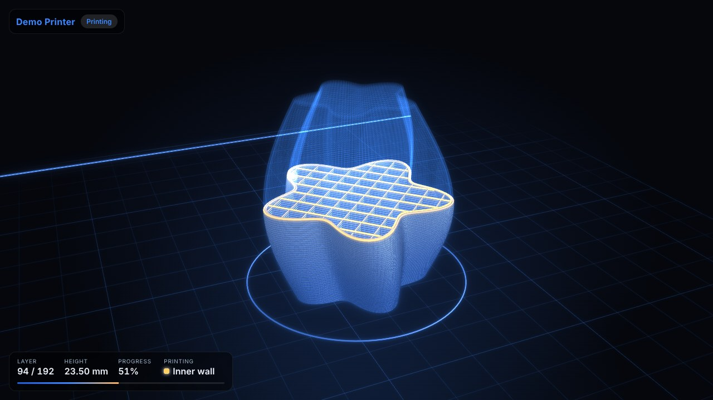
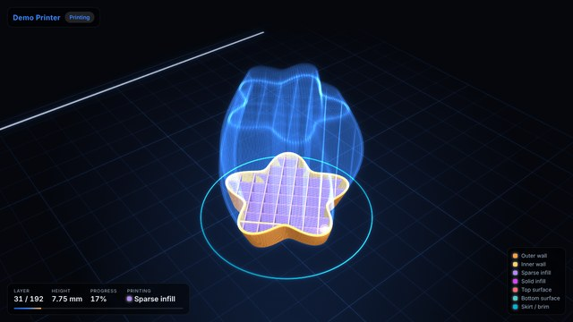

# OBS Print Progress Overlays

Real-time 3D printer status overlay for OBS Studio. Display print progress, temperatures, layer info, time estimates, camera feed, and G-code thumbnails from any Klipper/Moonraker printer.

## Quick Start

**New to this project?** Follow these steps:

1. **Download** - Clone or download this repository to your computer
2. **Configure** - Copy `printers.json.example` to `printers.json` and edit:
   - Set `id`: unique name (e.g., "printer1")
   - Set `ip`: your printer's IP address (e.g., "192.168.1.100")
   - Set `name`: display name for the overlay
3. **Start Server** - Run `start-server.bat` (Windows) or `./start-server.sh` (Mac/Linux)
4. **Add to OBS** - Create Browser source with URL: `http://localhost:8000/printer.html?printer=printer1`
5. **Configure Moonraker CORS** - See [CORS setup](#cors-issues) if overlay shows connection errors

That's it! The overlay will auto-update every 2 seconds with your printer's status.

## Files

- `printer.html` – the only HTML you load in OBS (`?printer=<id>` selects the printer)
- `printers.json` – array of printer configs (id, ip, camera, flips, etc.)
- `print-progress.css` – shared styling
- `print-progress.js` – shared logic (polls printer + updates overlays)
- `start-server.bat` – Windows helper to run a local server
- `start-server.sh` – macOS/Linux helper to run a local server
- `toolpath.html` – optional **Live Toolpath** overlay: a real-time 3D twin of the print (see below)
- `gcode-toolpath.js`, `toolpath-renderer.js`, `toolpath.js`, `toolpath-demo.js`, `toolpath.css` – Live Toolpath parser, WebGL renderer, app logic, demo generator and styling

Keep everything in the same folder.

## Configure printers

1) Copy `printers.json.example` to `printers.json` (this file is git-ignored; keep your real IPs out of source control).
2) Edit `printers.json`:
   - `id`: value used in the query param
   - `name`: Friendly printer name shown on the overlay
   - `ip`: Printer API host (e.g., `printer1.local` or `192.168.x.x`)
   - `camera`: Optional; leave blank to auto-build `http://<ip>/webcam/?action=stream` so the IP is only entered once
   - `flipHorizontal` / `flipVertical`: Optional booleans to mirror/flip the camera stream if the raw feed is reversed
   - `showChamber`: `true` to show chamber temp if your config exposes a chamber temperature sensor (e.g., `temperature_sensor chamber` or `heater_generic chamber`)
   - `updateInterval`: Poll rate in ms (default 2000)
   - `debug`: `true` to show debug info, `false` to hide

Moonraker/Mainsail CORS (needed for browser/OBS access):
Add this to `mainsail.cfg` (or your main `moonraker.conf`), adjusting the IPs to match your OBS/desktop machine:

```ini
[server]
cors_domains:
  http://localhost
  http://127.0.0.1
  http://localhost:8000
  http://<your-obs-ip>:8000
  http://192.168.x.x   # your OBS/desktop IP
  null                 # allows file access
```

Camera orientation tips:

- Check the raw stream (same URL the overlay uses). If it's mirrored or upside down compared to Mainsail's preview, set `flipHorizontal: true` and/or `flipVertical: true` in `printers.json`.
- In OBS you can also right-click the Browser source → Transform → Flip to adjust per-source.

## Select a printer in OBS

1) Start a local server:
   - Windows: double-click `windows-server-start.bat`
   - macOS/Linux: run `./linux-mac-server-start.sh` (ensure it's executable: `chmod +x linux-mac-server-start.sh`)
2) In OBS, add a **Browser** source and set the URL to `http://localhost:8000/printer.html?printer=<id>` (matching an `id` from `printers.json`).
3) Set the source width/height you want; the overlay will scale to fit.
4) If loading over `file://` fails due to CORS, serve via the local server (above), embed configs inline, or pass everything via query params.
5) If the camera doesn't load, it will automatically retry up to 3 times with exponential backoff.

### Query Parameter Options

You can customize the overlay using URL parameters (useful for quick testing or overriding config):

```bash
http://localhost:8000/printer.html?printer=printer1&debug=true
```

Available parameters:

- `?printer=<id>` - Select printer from printers.json by ID
- `?ip=<address>` - Override printer IP address
- `?name=<name>` - Override printer display name
- `?camera=<url>` - Override camera URL
- `?flipX=1` or `?flipHorizontal=true` - Mirror camera horizontally
- `?flipY=1` or `?flipVertical=true` - Flip camera vertically
- `?chamber=1` or `?showChamber=true` - Force show chamber temperature
- `?interval=2000` or `?updateInterval=2000` - Set poll interval in milliseconds
- `?debug=true` - Enable debug mode to show detailed information

Examples:

```bash
# Use specific printer with debug enabled
http://localhost:8000/printer.html?printer=printer1&debug=true

# Override everything via query params (no printers.json needed)
http://localhost:8000/printer.html?ip=192.168.1.100&name=MyPrinter&chamber=1&debug=1

# Quick test with custom poll interval
http://localhost:8000/printer.html?printer=printer2&interval=5000
```

## Live Toolpath (3D digital twin)



`toolpath.html` is a second, independent overlay. It downloads the G-code file currently printing from Moonraker, rebuilds every extrusion move in 3D, and grows the model in sync with the real printer:

- **Printed part** is drawn as shaded plastic beads, with visible layer lines
- **Hot trail**: the most recently extruded path glows and cools down behind the nozzle
- **Holographic ghost** of the part of the print that hasn't been printed yet, with a scanline sweeping through it
- **Nozzle tracking**: uses `motion_report.live_position` to find the segment the nozzle is actually on. Klipper reads ahead of the nozzle, so `file_position` alone would run ahead
- **Victory lap**: when the print completes, the whole build replays in a few seconds
- Live via the Moonraker **websocket** (falls back to HTTP polling); the model appears progressively while the file downloads
- Transparent background in OBS, so you can stack it over or beside the camera overlay

### Try it without a printer

```bash
http://localhost:8000/toolpath.html?demo=1
```

Demo mode generates a sliced-looking twisted star tower in the browser and simulates printing it (with lookahead and a Z offset, like a real Klipper machine).

### Use it in OBS

Add a **Browser** source with the same printer selection as `printer.html`:

```bash
http://localhost:8000/toolpath.html?printer=printer1
```

It uses the same `printers.json`, the same Moonraker CORS settings (see [CORS Issues](#cors-issues)) and the same `theme-custom.css` colours. It needs WebGL2: keep **Settings → Advanced → Sources → Enable Browser Source Hardware Acceleration** turned on in OBS.

### Options

| Parameter | Default | Description |
| --- | --- | --- |
| `printer` / `ip` / `name` | | Select or override the printer, same as `printer.html` |
| `demo` | `0` | Simulated print, no printer needed |
| `color` | `height` | `height` (theme gradient), `feature` (walls / infill / supports... from slicer `;TYPE:` comments) or `speed` (feedrate heatmap) |
| `spin` | `8` | Auto-rotation in degrees per second (`0` to stop) |
| `pitch` | `26` | Camera elevation in degrees |
| `zoom` | `1` | Zoom factor |
| `trail` | `300` | Length of the glowing hot trail, in segments |
| `width` | `0.45` | Bead width in mm |
| `ghost` | `1` | `0` hides the unprinted remainder |
| `hud` | `1` | `0` shows only the 3D view |
| `glow` | `1` | `0` disables the CSS glow (saves GPU) |
| `fps` | `60` | Frame-rate cap (`30` is plenty for streaming) |
| `transparent` | auto | Transparent background. Automatic in OBS; set `1` to force it in a normal browser |
| `demoDuration` | `150` | Seconds per simulated print in demo mode |

In a browser (or OBS **Interact**) you can drag to orbit, scroll to zoom and double-click to reset.



### Notes and limits

- Works with PrusaSlicer, SuperSlicer, OrcaSlicer, Bambu Studio and Cura output; G2/G3 arcs are supported.
- The whole file is downloaded once per print. Parsing runs at roughly 25 MB/s. A very large file (100 MB+) costs a few hundred MB of memory, so on weaker streaming PCs use `?ghost=0&fps=30`.
- Layers come from slicer layer-change comments when present (vase mode included), otherwise from Z changes.
- If the model loads but never progresses, check that `virtual_sdcard` and `motion_report` exist in your Klipper config (`[virtual_sdcard]` is required for printing from Mainsail/Fluidd anyway).

## Customizing Colors (Themes)

The overlay supports custom color themes. Several example themes are included in `theme-custom.css.example`:

- Blue (default)
- Purple/Violet
- Green/Emerald
- Orange/Amber
- Red/Rose
- Cyan/Teal

### Creating Your Own Theme

1) Copy `theme-custom.css.example` to `theme-custom.css`
2) Uncomment your preferred theme or customize the CSS variables:
   - `--theme-primary`: Main accent color (progress bar, status)
   - `--theme-secondary`: Secondary accent (progress gradient)
   - `--theme-progress`: Progress bar color
   - `--theme-glow`: Loading state glow
   - `--theme-thumbnail-glow`: Thumbnail glow effect
3) Save and refresh your OBS browser source

The custom theme is **automatically loaded** if it exists - no need to modify any HTML!

## Development & Testing

This project uses **Test-Driven Development (TDD)** with the **Arrange-Act-Assert (AAA)** pattern to ensure reliability and prevent regressions.

### Running Tests

```powershell
node tests/print-progress.test.js
node tests/gcode-toolpath.test.js
```

All tests must pass before committing changes. See [TESTING.md](TESTING.md) for detailed testing guide.

### Test Coverage

- **Progress Calculation** - 4 tests verifying virtualSdcard.progress usage and edge cases
- **Layer Calculation** - 2 tests for layer count from metadata and fallback heights
- **Time Parsing** - 3 tests validating filename parsing for "1d1h42m" and layer heights
- **Time Calculation** - 4 tests for formatting, remaining time, and edge cases
- **Layer Formatting** - 3 tests for "current / total" display with missing data
- **Metadata Parsing** - 3 tests for gcode comment parsing (layer height, estimated time)
- **Percentage Calculation** - 2 tests for conversion and rounding edge cases
- **Null Safety** - 2 tests for optional chaining (?.) and nullish coalescing (??)

**Total: 23 comprehensive tests** - Run with `node tests/print-progress.test.js`

The Live Toolpath parser has its own suite (`tests/gcode-toolpath.test.js`, 23 tests), covering absolute and relative moves (G90/G91/M82/M83/G92), arcs, slicer feature and layer comments, exact byte offsets with CRLF/UTF-8 and arbitrary chunk boundaries, `file_position` mapping, nozzle-position refinement, and the demo generator.

### Contributing

When adding features or fixing bugs:

1. Write test first (TDD approach)
2. Run test - should fail initially
3. Implement fix in print-progress.js
4. Run test again - should pass
5. Commit test and fix together

This approach prevents regressions and documents expected behavior.

## Troubleshooting

### Camera Feed Not Loading

1. **Check camera URL** - Visit the camera URL directly in your browser to verify it works
2. **Automatic retry** - The overlay will retry failed camera loads 3 times with exponential backoff (1s, 2s, 4s)
3. **CORS issues** - Ensure your camera stream allows cross-origin requests
4. **Camera format** - MJPEG streams work best; RTSP may require OBS VLC source instead

### Cannot Connect to Printer

- **Error: "Unreachable: \<ip\>"** - Printer IP is incorrect or printer is offline
  - Verify printer IP: `ping <printer-ip>`
  - Check printer is powered on and connected to network
  - Try accessing Mainsail/Fluidd at `http://<printer-ip>` in browser

- **Error: "Authentication Error"** - Moonraker requires authentication
  - Check Moonraker configuration for auth settings

- **Error: "API Not Found"** - Moonraker is not running or wrong port
  - Verify Moonraker service is running on the printer
  - Default port is 80; if different, include in IP (e.g., `192.168.1.100:7125`)

### CORS Issues

If you see CORS errors in the browser console:

1. **Add CORS domains to Moonraker** - Edit `moonraker.conf` or `mainsail.cfg`:

   ```ini
   [server]
   cors_domains:
     http://localhost
     http://localhost:8000
     http://192.168.x.x    # Your OBS machine IP
     null                  # For file:// access
   ```

2. **Restart Moonraker** after config changes:

   ```bash
   sudo systemctl restart moonraker
   ```

### Metadata Not Showing (Layers, Time)

The overlay tries multiple methods to get print metadata:

1. **Moonraker API** - First tries Moonraker's metadata API
2. **G-code header** - Falls back to parsing G-code file directly
3. **Filename parsing** - Last resort: extracts info from filename
   - Layer height: `file_0.2_name.gcode` → 0.2mm
   - Time: `file_1h46m_name.gcode` → 1 hour 46 minutes

If still not working:

- Enable debug mode: `?debug=true`
- Check console for "metadata" messages
- Verify G-code file has proper comments from slicer

### Debug Mode

Enable detailed diagnostics by adding `?debug=true` to your URL or setting `debug: true` in `printers.json`:

```bash
http://localhost:8000/printer.html?printer=printer1&debug=true
```

Debug output shows:

- Current state and progress
- Layer detection sources and calculations
- Metadata loading status and source
- Time estimate calculations
- Configuration values

### Overlay Not Updating

1. **Check UPDATE_INTERVAL** - Default is 2000ms (2 seconds), configured via `updateInterval` in printers.json or `?interval=` query param
2. **Browser cache** - Hard refresh the OBS browser source (right-click → Refresh)
3. **Server not running** - Ensure `start-server.sh` or `start-server.bat` is running if using `localhost:8000`

### Chamber Temperature Not Showing

Chamber detection is automatic but requires:

- `showChamber: true` in `printers.json` OR `?chamber=1` in URL
- A temperature sensor with one of these names in Klipper config:
  - `[temperature_sensor chamber]`
  - `[temperature_sensor enclosure]`
  - `[temperature_sensor chamber_temp]`
  - And several other variations (see code for full list)

If you have a chamber sensor but it's not detected:

- Enable debug mode to see what sensors are found
- Check your Klipper config for the exact sensor name
- The overlay caches sensor names for 30 seconds

## Notes

- Debug info renders in a small block at the bottom; leave `debug: false` for clean output.
- If you move the folder, repoint the Browser source(s) to the new path.
- `theme-custom.css` and `printers.json` are gitignored to preserve your customizations across updates.
- Camera feed automatically retries on failure (up to 3 attempts with exponential backoff).
- API connection automatically retries on network errors (up to 5 attempts with exponential backoff).
