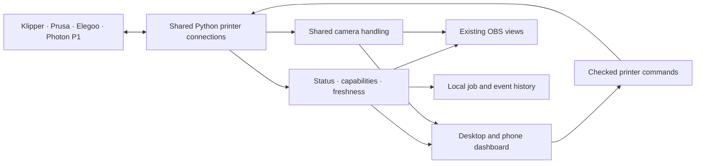

# Printer dashboard decision

Decision date: 2026-11-14. Cody delegated the choice after asking for a fresh comparison with modern alternatives. This decision replaces the tentative recommendation in `dashboard-direction.md`. Research and source inspection only; no printer commands, installation or application changes were performed.

The [specification package](spec/README.md) now develops this direction through CSDM 5, CMDB, ITIL 4, SDLC and TDD. Use its requirements and acceptance plan for proposed delivery scope; this document remains the research/reuse decision record.

Source coverage corrected: all 47 stored Maker Watch reports have now been read. The [15-entry source index](dashboard-makerwatch-index.md) recovers the exact projects Cody meant; the [candidate source review](dashboard-makerwatch-candidates.md) checks the closest ones. These candidates take priority over the generic layout references below.

## Choice

Evolve this repository into a local printer dashboard. Keep the existing Python connection layer and OBS views. Build a distinct responsive dashboard over a shared printer status/control interface. Use established projects for selected integrations and interaction patterns instead of adopting a whole farm-management platform.

This is a fit decision, not a claim that a custom app has more features than the alternatives. The reasons are the combined filament/resin fleet, existing OBS work, the need for precise per-printer behavior, and Cody's previously stated preference for an easy packaged download. No reviewed ready-made product was demonstrated to cover all eight current/planned machines, unified controls, and these OBS views without additional integration work.

PF PrintFloor is the strongest direct reuse candidate. Gantry is the closest broad desktop-product reference, while Home Assistant is the strongest general integration-host alternative. Keep this repository as the application host: PrintFloor lacks our full printer/control scope, Gantry's documented local phone panel is read-only, and requiring Home Assistant would shift installation and printer connections into another application plus several custom integrations. Maintaining an independent dashboard preserves a direct install path for people who only want printer tools.

## Alternatives and their role

| Candidate | Evidence and limitation | Decision |
| --- | --- | --- |
| PF PrintFloor | MIT Python/browser dashboard for CC1, Klipper and Bambu; status-only for jobs. Reviewed models, browser script and shared camera implementation: [source review](dashboard-makerwatch-candidates.md). | Primary donor: selectively adapt fleet presentation, state semantics, camera sharing and lifecycle behavior. Keep our existing adapters and OBS views. |
| Gantry (`parametryczny/Gantrybar`) | Broad desktop product with farm/maintenance tools and optional web viewing. Its current SLA guide specifically lists experimental Saturn 4 Ultra and Photon P1 monitoring, simulated rather than physically qualified, without resin controls or built-in cameras. Local phone panel is read-only. See [candidate review](dashboard-makerwatch-candidates.md). | Closest broad mixed-fleet alternative and primary workflow reference. It still does not provide the verified resin/phone controls and OBS experience we need. |
| PrintForge (`lloyd-kay/PrintForge`) | Klipper queue with persistent reservations, bed-clear gates and uncertain-start handling. Hardware acceptance remains pending: [source review](dashboard-makerwatch-candidates.md). | Queue and recovery design reference if dispatch is added; no full-backend adoption. |
| Printroom (`77kmp9jr2f-jpg/printroom`) | Exact September 22 Maker Watch project; current source is a Moonraker-focused web dashboard: [candidate review](dashboard-makerwatch-candidates.md). | Borrow freshness indicators and bounded camera/poll scheduling. Do not confuse it with Print Room HQ. |
| Home Assistant | Specific community integrations now include the Photon P1 as well as other printer families; capability and maturity differ by integration. See [platform research](dashboard-modern-platforms.md). | Best alternative if the whole workshop is already organized around HA. Borrow capability-aware controls, entity availability and history; optional integration later. |
| FDM Monster | Fleet-oriented alternative; source comparison and release caveats are in [platform research](dashboard-modern-platforms.md). | Secondary grid/grouping reference after the closer Maker Watch candidates; no fleet-wide migration. |
| Mainsail / Fluidd | Klipper-focused interfaces. Mainsail documents separate desktop/mobile layouts and collapsible panels: [layout docs](https://docs.mainsail.xyz/features/dashboard-organisation/). | Borrow information hierarchy and responsive detail panels; preserve native links for advanced tuning. |
| Node-RED / FlowFuse Dashboard | A general automation and dashboard toolkit, not a ready-made mixed-printer connection layer. Current versus legacy dashboard distinction is in [platform research](dashboard-modern-platforms.md). | Borrow event/notification thinking; no required flow editor or extra runtime. |
| Obico | Self-hostable monitoring and failure detection, with documented OctoPrint/Klipper paths: [server](https://github.com/TheSpaghettiDetective/obico-server), [Klipper setup](https://www.obico.io/docs/user-guides/klipper-setup/). Self-hosting adds Docker and other server setup. Reviewed sources do not establish Saturn/P1 coverage. | Optional later failure-detection integration; no AI detector built for the first dashboard. |
| OctoEverywhere | Current source advertises Klipper, Centauri Carbon and PrusaLink companions, notifications, camera streaming and remote access: [README](https://github.com/QuinnDamerell/OctoPrint-OctoEverywhere). Its [release page](https://github.com/QuinnDamerell/OctoPrint-OctoEverywhere/releases) lists 5.4.1 with an October 24 release entry. Resin support for this fleet was not established. | Optional later off-site access/notification provider; avoid requiring a cloud account for local dashboard operation. |
| Repetier-Server | Official [2.0.1 release](https://github.com/repetier/Repetier-Server/releases/tag/v2.0.1) says development is discontinued. Official [repository](https://github.com/repetier/Repetier-Server) contains installers, not application source. | Reject as a new foundation. Earlier recommendation is obsolete. |
| OctoFarm | Earlier OctoPrint-centric candidate; see [platform research](dashboard-modern-platforms.md) for current evidence. | Do not restart the old Windows/MongoDB setup as the dashboard foundation. |
| Printer Tools | Its [current compatibility list](https://printertools.app/compatibility) includes Klipper, Prusa MINI and Centauri Carbon. Its Anycubic list is Kobra FDM; its Elegoo list is FDM. Those listings do not demonstrate Photon P1 or Saturn 4 Ultra support. | Useful modern example of explicit compatibility and mixed-brand presentation, not a demonstrated complete replacement. |
| PrinterHive / SimplyPrint | Broader farm-management offerings; [PrinterHive's setup](https://docs.printerhive.com/) requires cloud sync, and its [compatibility page](https://docs.printerhive.com/getting-started/supported-printers) is model-specific. SimplyPrint findings are in [platform research](dashboard-modern-platforms.md). | Queue, file and production-workflow references; do not make a hosted farm subscription the local dashboard's foundation. |

## What to borrow

Implement these interaction patterns independently; this is not permission to copy arbitrary source files or artwork.

| Source | Pattern | Concrete dashboard behavior |
| --- | --- | --- |
| PF PrintFloor; Gantry; FDM Monster | Fleet grid, density and grouping | Eight cards; full/compact/list presentation; filter by printing, attention, idle/offline and filament/resin. Pin/reorder printers. Distinguish offline from stale last-known state. |
| PF PrintFloor | Shared cameras and visible connection states | One upstream camera where possible; pause background previews, show authentication/connection-slot failures separately from job failure, retain last-seen timestamps. |
| PrintForge; Gantry | Production and pickup states | Future queue work must separate a completed print from an empty bed and a successful command delivery from a confirmed print start. |
| Mainsail / Fluidd | Task-focused detail panels | Current job and camera first; temperatures and supported controls next; advanced tuning opens the native printer interface. Phone layout prioritizes job and controls. |
| Home Assistant | Availability and capability model | Each printer advertises what it can report and do. Missing hardware is omitted; an unavailable supported feature gets an explanation. |
| Obico / OctoEverywhere | Attention and notification workflow | An event feed for completed, paused, failed and disconnected printers. Deduplicate notifications and include the printer/job identity. |
| Spoolman | Separate material inventory | Add a later link to an existing spool record rather than inventing a parallel filament database: [project](https://github.com/Donkie/Spoolman). Keep resin inventory distinct. |
| Existing 3DBrain fleet board | Maintenance context | A future printer detail tab can show documented issues and maintenance, clearly separated from live telemetry. The notes remain their own source of truth. |
| Earlier OBS project plan | Personalization and approachable installation | Theme presets with live preview; retain per-printer OBS URLs; add a combined fleet overlay after the main grid; package the app for end users. |

## Actual reuse candidates

### PF PrintFloor

Selectively adapt its reviewed [status models](https://github.com/pomeroyfamily/pf-printfloor/blob/main/app/models.py), [fleet presentation](https://github.com/pomeroyfamily/pf-printfloor/blob/main/app/static/app.js) and [camera hub](https://github.com/pomeroyfamily/pf-printfloor/blob/main/app/cameras.py), preserving its MIT attribution when code is imported. Split reused browser behavior into small modules; do not import the entire large script or its smart-plug automation. Treat camera enablement as an explicit operation. Exact reviewed file identifiers and exclusions are in the [source review](dashboard-makerwatch-candidates.md). No code has been imported yet.

### Photon P1

Use [modrzew/hass-anycubic-photon-p1](https://github.com/modrzew/hass-anycubic-photon-p1) as the primary implementation reference. It has an [MIT license](https://github.com/modrzew/hass-anycubic-photon-p1/blob/main/LICENSE.md), local HTTP/MQTT communication, and [protocol notes](https://github.com/modrzew/hass-anycubic-photon-p1/blob/main/docs/protocol.md). Review and pin a source revision before adapting reusable pieces, retaining attribution for imported code.

The integration reports a one-MQTT-client restriction: Photon Workshop and another direct client can displace each other. Make the dashboard host the connection owner, with explicit disconnect/reconnect and visible contention. Do not run independent HA and dashboard clients against the P1 simultaneously by default.

Source inspection also found inconsistent signature ordering between that project's protocol notes and its implementation; the implementation agrees with the local probe's ordering. Do not change the probe from documentation alone. Exact commands and camera behavior still require validation on Cody's firmware. See [platform research](dashboard-modern-platforms.md).

### Browser cameras

Evaluate [go2rtc](https://github.com/AlexxIT/go2rtc) as an optional managed camera helper for streams the browser cannot directly play. It supports multiple stream formats and browser outputs, runs as a standalone binary, and uses FFmpeg only where conversion is needed. Keep existing browser-playable feeds direct/proxied. Confirm actual camera codecs before adding conversion; do not promise every RTSP/FLV source works without extra processing. Bundle only the needed platform helper after validation.

### Printer commands

Use the manufacturer's interfaces where available, rather than translating every machine into arbitrary G-code. Prusa's [OpenAPI specification](https://github.com/prusa3d/Prusa-Link-Web/blob/master/spec/openapi.yaml) describes job-ID-specific pause/resume/stop requests. Elegoo's [SDCP specification](https://github.com/cbd-tech/SDCP-Smart-Device-Control-Protocol-V3.0.0) is the starting point for SDCP controls. Verify model/firmware support before enabling each action.

## Architecture selected

- Keep one repository and one application host. Keep Python for protocols; use separate browser modules for dashboard data, cards, detail, themes and interactions. Initially retain the current HTML/CSS/JavaScript approach; a framework migration is not required to add a responsive dashboard.
- Preserve `printer.html` and `toolpath.html` URLs. Add a dashboard route and keep setup accessible throughout migration.
- Expand shared status with elapsed/remaining time, temperature targets, chamber/resin readings, source timestamps, connection state and capabilities. Do not convert unknown values to zero or estimate elapsed time without marking it as estimated.
- Centralize frontend subscriptions/polling so cards do not each establish printer connections. Fan out cached state from the host; start with aggregate polling and introduce a server event stream only when useful.
- Add SQLite for observed jobs and event history when those features are built. Record disconnects and observation gaps; do not present observed history as a complete lifetime printer ledger.
- Expose a small command interface: action, printer, expected job/state and request ID. Display pending, accepted, confirmed, failed or unknown outcome. A delivered command is not proof the printer changed state. Do not blindly retry after a timeout.
- Phone access initially means the same LAN. Add authenticated control and consistent request protections, including legacy proxy write paths, before enabling network control. Off-site access is a separate optional integration.

## Delivery order selected

1. **Responsive live dashboard:** actual fleet cards, attention filters, detail page, shared state/freshness/capabilities, existing cameras and retained OBS links. Present unconnected additions honestly. Use a clearly labeled simulator for visual development.
2. **Mixed-fleet controls:** implement and test pause/resume/cancel per family; validate the Prusa MINI and Saturn path, then the new P1 adapter. Keep advanced native controls available. Handle P1 connection ownership explicitly.
3. **Daily-use features:** event/job history, temperature trends, theme editor, saved layout and a combined OBS fleet view. Review resin-specific fields such as release-film usage when the printer reports them.
4. **Distribution and phone readiness:** package an executable with setup in the browser; shared camera helper where required; authenticated LAN use; test desktop, Android/iOS browser behavior and OBS regression scenarios.
5. **Optional integrations:** Spoolman, 3DBrain maintenance context, Home Assistant and a selected remote-monitoring provider. Add production queues/file dispatch only if they become an actual workflow need.

The next implementation milestone is a working fleet overview in this repository. It should establish the final UI direction and shared data model while preserving the existing printer views. No migration to Home Assistant, Node-RED, Repetier or an external farm platform is planned.

## Validation limits

This comparison used project-owned documentation, repositories and selected source files. It is not a hands-on installation trial. Advertised integrations are not proof that every control or camera works on every model. Current running services and printers were left untouched. The earlier simulated test baseline is recorded in [dashboard-direction.md](dashboard-direction.md); no code tests were rerun for these documentation-only changes.
