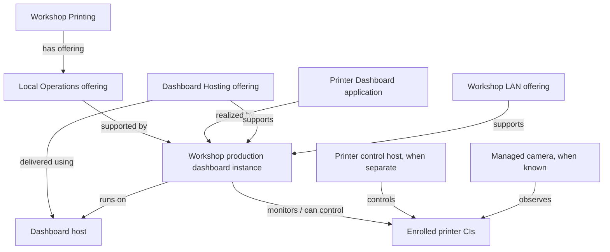

# Service model and CMDB

Status: Draft 0.1. A logical information model; storage tables and APIs are intentionally unspecified. Framework terminology and primary sources are in [framework reference](framework-reference.md). Names and relationships below are the workshop's proposed adaptation.

## Service map

| Concept | Workshop record | Meaning |
| --- | --- | --- |
| Business capability | Printer Fleet Operations | What the workshop needs to be able to do |
| Business service | Workshop Printing | The outcome-oriented service of producing physical printed parts |
| Business service offering | Workshop Printing — Local Operations | Proposed scope: enrolled workshop printers, local monitoring and qualified operator controls; commitments and support hours remain to be established |
| Business application | Printer Dashboard | The designed application in the application inventory, independent of a particular installation |
| Service instance, application-service realization | Printer Dashboard — Workshop — Production | The actual deployed application stack supporting local operations; host/version must be recorded before activation |
| Technology management service | Dashboard Hosting | Responsibility for keeping the dashboard host, runtime and persistent records operable |
| Technology management offering | Dashboard Hosting — Workshop Local Host | The specific proposed hosting scope supporting the production deployment |
| Technology management service | Printer Connectivity | Responsibility for the network access and connection facilities supporting managed printer communication |
| Technology management offering | Printer Connectivity — Workshop LAN | The proposed local network scope; it does not imply off-site access or an uptime guarantee |
| Supporting CIs | Individual printers, control hosts, dashboard host and managed cameras | Identified supporting equipment or deployed software, with actual dependencies |

These are modeling roles, not new organizations or installed ServiceNow records. Cody may occupy all owner roles. An offering describes scope and commitments; each protocol, card, printer or feature does not need another offering. Do not introduce an operational-process service instance for Workshop Printing unless an actual process-management need justifies it.

Relationship labels in this diagram are local conceptual names. Deployment and equipment topology require verification; an embedded printer host must not be invented as a separate physical computer merely because a protocol exists.

## Managed records

| Record | Identity/lifecycle purpose | First-release requirement |
| --- | --- | --- |
| Printer CI | Individual physical machine, including filament/resin technology | Required for each enrolled or planned fleet member |
| Host CI | Individually managed computer running dashboard or printer-control software | Required for production dashboard host; printer hosts only when known and operationally relevant |
| Camera CI | Individually managed camera with its own identity/configuration | Optional where identifiable; a stream URL alone is not enough to invent equipment |
| Deployed application CI/service instance | Particular production or non-production dashboard deployment | Required before deployment; link application and host |
| Product/model reference | Manufacturer/model identity shared by equipment of a type | Known values required; unknown model remains unknown |
| Service/offering record | Outcome, scope, owner and supporting realization | Minimal records above; do not expand into a complete service catalog |
| Endpoint descriptor | Protocol/address/port/path and observed reachability | Associated configuration, not automatically another CI |
| Capability record | Reading/action, compatibility constraints and support evidence | Required for dashboard presentation and control eligibility |
| Secret reference | Reference to protected connection credentials | Associated configuration; raw values never appear in CMDB views or ordinary exports |

The CMDB is a curated record of service-relevant configuration. Financial asset ownership, procurement, warranties and consumables may link to it later, but they are not mandatory fields for a useful printer CI. Filament spools and resin stock are not automatically infrastructure CIs.

## Minimum CI information

| Group | Required information |
| --- | --- |
| Identity | Immutable internal CI identifier, class, display name, existing printer/OBS alias; manufacturer/model and vendor serial/board identity when known |
| Accountability | Owner, custodian/operator, location or explicit unknown, source of each assertion |
| Configuration | Technology family, intended protocol/endpoints, intended camera orientation, authentication reference, expected observation interval |
| Lifecycle | Planned, active, maintenance or retired; effective date and reason; operational connection/job state stored separately |
| Evidence | Source, recorded/observed time, verified-by and verification method; model/firmware scope for support claims |
| Baseline | Reviewed configuration revision, changes since that revision and related change record where applicable |
| Relationships | Relevant linked CIs/services, relationship type, validity dates, evidence and verification status |

Unknown fields may remain unknown. Enrollment does not require fabricating serial numbers, locations, ownership groups or support commitments. Serial numbers are identifiers, but should still be excluded from public/OBS outputs unless specifically needed.

## Identification and reconciliation rules

1. Assign a stable internal identity to the physical machine. Preserve its existing OBS/printer alias as a compatible lookup; renaming does not require changing either identity.
2. Treat address, hostname and display name as mutable attributes. They are not sufficient keys for automatic merging.
3. Prefer vendor-scoped serial/board identity when actually available. Keep manufacturer/model context; record conflicts rather than assuming identifiers are globally unique.
4. A discovery is an observation/proposal until enrollment or reconciliation accepts it. A high-confidence match may propose an endpoint update; ambiguous matches enter review and do not overwrite an active connection.
5. Replacing a printer with another at the same address creates a new physical CI. Retain the predecessor, effective relationship changes and old history. Resolve whether an OBS alias should intentionally move as a separate configuration decision.
6. A replaced control board may change reported identity while the physical printer remains the same. Reconcile using explicit maintenance/replacement evidence, retaining old identifiers as dated history.
7. A routine disconnect does not retire a CI. Maintenance does not imply disconnected, and connected does not imply eligible for new work.
8. Retire records instead of deleting operational history. Remove access credentials when no longer needed; preserve non-secret provenance according to retention policy.
9. Importing the current configuration creates explicit legacy mappings. A migration must report duplicate/conflicting records and provide a reversible preview before activation.

## Source authority and drift

| Information | Authority | Reconciliation behavior |
| --- | --- | --- |
| Intended name, ownership, placement and enrollment | Operator-maintained inventory | Discovery never silently replaces these |
| Intended endpoint/orientation/configuration | Reviewed dashboard configuration | Observed differences create a drift proposal |
| Current temperatures/job/connection | Most recent applicable printer observation | Replace live values with source time/provenance; retain age and last-known values when communication fails |
| Firmware/model evidence | Reported printer identity plus verified evidence | Surface changed firmware; reassess affected capability qualification |
| Hardware support claim | Capability evidence record | Device discovery alone cannot promote a command to physically verified |
| Existing maintenance/design knowledge | Linked 3DBrain records | Link and identify source; do not silently duplicate or overwrite those records |
| Secrets | Protected credential storage | Expose reference/status only; no raw secrets in drift/audit/export |

Every conflict needs enough source information to explain why the values differ. Browser retrieval time is not source-observation time. A transport heartbeat can confirm a connection without making every previously received measurement fresh.

## Allowed relationships and impact rules

| Relationship | Direction/cardinality expectation | Impact interpretation |
| --- | --- | --- |
| application realized by deployment | One application may have several deployments | A test deployment failure is not automatically a production outage |
| deployment runs on host | One or more recorded hosting dependencies | Failed dashboard host affects dashboard/overlays; do not infer that autonomous prints stopped |
| dashboard monitors printer | One deployment may monitor many printers | Losing monitoring affects visibility; last job outcome becomes unknown if unobserved |
| dashboard can control printer | Only where a qualified permitted capability exists | Monitoring support does not establish command support |
| control host controls printer | Record actual shared/individual topology | A failed shared control host may affect several printers; distinguish this from a failed dashboard host |
| camera observes printer | Many-to-many only when intentionally configured | Camera failure degrades the camera view, not proof of printer failure |
| item located at location | Optional location hierarchy | Supports grouping and investigation; location changes are not hardware replacement |
| item replaced by item | Dated historical link | History remains attached to the machine on which it happened |

Retain inactive/expired relationships for historical impact analysis. Show inferred and verified dependencies differently. Avoid a simple green/red fleet roll-up that treats all dependencies as equal or current job completion as an empty build surface.

## Records adjacent to the CMDB

| Record | Required links/meaning |
| --- | --- |
| Observation | Source CI/endpoint, source and receive times, measurement scope, quality and value |
| Job | Printer CI, execution identity, file reference, observed start/end and outcome; uncertainty/observation gaps retained |
| Command record | Target CI/job, actor, action, request identity, times and outcome; sanitized evidence |
| Event | Affected CI/service, transition, time, source and deduplication identity |
| Incident | Service impact, related CIs/events, owner, restoration and resolution evidence |
| Problem | Related incidents, investigation, known cause/workaround and corrective action |
| Change record | Scope/affected CIs, reason, risk, authority, baseline, implementation/rollback and result |
| Maintenance record | Equipment CI, planned/completed work, person, evidence, parts and result |

These records reference the CMDB; they do not become CIs merely because they are stored. Extended maintenance/problem workflows can initially live in linked records and operating procedures rather than requiring a full ticketing product.

## Required edge cases

- Hoss changes address: retain identity, OBS alias and history; reconcile the endpoint.
- Another printer takes Hoss's old address: report identity conflict, block control through that mismatched connection.
- Two printers share a model/name: keep distinct CIs.
- Lucee's camera fails while SDCP remains healthy: show camera degradation and current job separately.
- Dashboard host restarts during a print: show an observation gap; do not synthesize a job cancellation or complete history.
- Photon Workshop displaces the P1 connection: represent contention and stale readings; do not change the P1's lifecycle or manufacture a print failure.
- A board is replaced during maintenance: preserve the physical printer CI only when reconciliation evidence establishes continuity.
